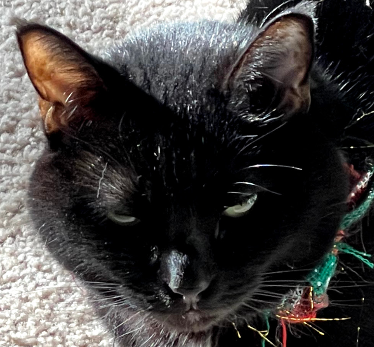

# BeanieTheCat Hooking Library

BeanieTheCat is a small C hooking library for x86 and x86-64 processes on Linux and Windows. It supports inline function hooks, import-table hooks, chained hooks, and trampoline calls back to the original implementation.



## Current Scope

Supported:

- Linux x86 and x86-64 builds.
- Windows x86 and x86-64 builds with MinGW cross compilers.
- Inline hooks by address or module/symbol name.
- Import-table hooks by module/symbol name.
- Chained hooks where each hook receives a trampoline to call the previous target.

Deferred:

- ARM64 Linux and Windows.
- macOS.
- Replacing Capstone with a smaller decoder backend.

ARM64 is intentionally parked for now. Capstone can support ARM64 decoding, but FLH would also need ARM64 patch encoders, trampoline relocation rules, instruction-cache handling, branch-protection consideration, and platform-specific validation.

## Repository Layout

```text
include/flh/          Public API
src/core/             Hook lifecycle and private hook-entry layout
src/asm/              Capstone-backed instruction decoder
src/platform/         OS memory, symbol, and import-table adapters
tests/                Characterization tests
third_party/          Vendored Capstone, plthook, and ntdll.h
assets/               Project assets
build/                Generated outputs, ignored by git
```

Implementation details such as `FLHEntry`, magic bytes, cast macros, and import-table sentinels are private. The public API is limited to hook and unhook operations in `include/flh/flh.h`.

## Public API

```c
void* flh_inline_hook(void* target_address, void* redirect_function_address);
void* flh_inline_hook_byname(const char* module_name, const char* function_name, void* redirect_function_address);
void* flh_import_table_hook_byname(const char* module_name, const char* library_module_name, const char* function_name, void* redirect_function_address);

int flh_inline_unhook(void* target_address);
int flh_inline_unhook_byname(const char* module_name, const char* function_name);
```

For inline hooks, the returned pointer is a trampoline that can be called to continue into the original function body. For import-table hooks, the returned pointer jumps to the original imported function.

## How It Works

Inline hooks overwrite the beginning of a target function with a jump into an allocated hook entry. The hook entry stores the original bytes, a trampoline, the top-level hook jump, and chained hook stubs.

The decoder uses Capstone to choose a safe instruction-aligned overwrite size and to rewrite copied relative call/jump instructions inside the trampoline. CET `ENDBR32` and `ENDBR64` instructions are replaced with NOPs in copied trampoline bytes.

Import-table hooks locate an import slot with vendored `plthook`, save the original function pointer, and patch the slot to point at an FLH hook entry. Unhooking restores the saved pointer.

## Build And Test

Linux x64:

```sh
make nix64_test
./build/nix64/test.elf
./build/nix64/test_iat.elf
cd build/nix64 && ./test_library.elf
```

Linux x86:

```sh
make nix32_test
./build/nix32/test.elf
./build/nix32/test_iat.elf
cd build/nix32 && ./test_library.elf
```

Windows cross-builds:

```sh
make win32_test
make win64_test
```

The Windows binaries are cross-compiled; run them only on Windows. Windows builds
need the MinGW cross toolchains (`i686-w64-mingw32-gcc`, `x86_64-w64-mingw32-gcc`)
on `PATH`. The Linux x86/x64 builds and tests and the Windows x86 cross-compile are
the paths that have been exercised; the Windows x64 path depends on a working
`x86_64-w64-mingw32-gcc`.

## Dependency Decisions

Capstone remains the supported decoder backend. It is heavier than a pure length decoder, but FLH currently relies on operand detail for trampoline relocation and CET handling. A lighter backend such as `x86_ldasm` may be evaluated later behind the decoder boundary, after tests cover prologue sizing, CET, relative relocation, malformed bytes, inline hooks, and import-table hooks.

Vendored dependencies live under `third_party/`:

- Capstone headers and static libraries.
- `plthook` source for ELF/PE import-table enumeration.
- `ntdll.h` declarations for Windows native APIs.

Do not edit vendored dependency internals during routine FLH refactors.

## Safety Notes

BeanieTheCat patches executable process memory. Run tests only in disposable local processes that you control. Do not change trampoline byte layout, hook-entry layout, or platform memory-protection behavior without passing the characterization tests.

Design internals and load-bearing invariants live in `ARCHITECTURE.md`.
